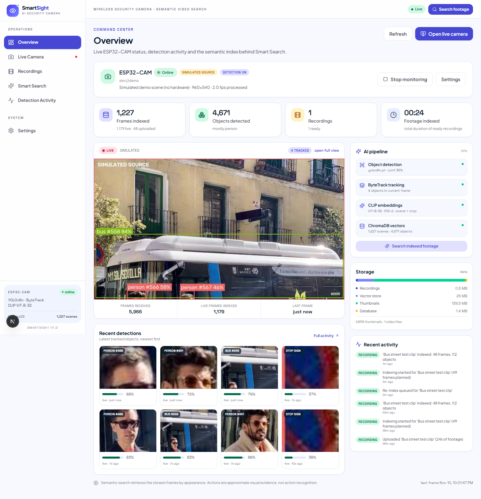
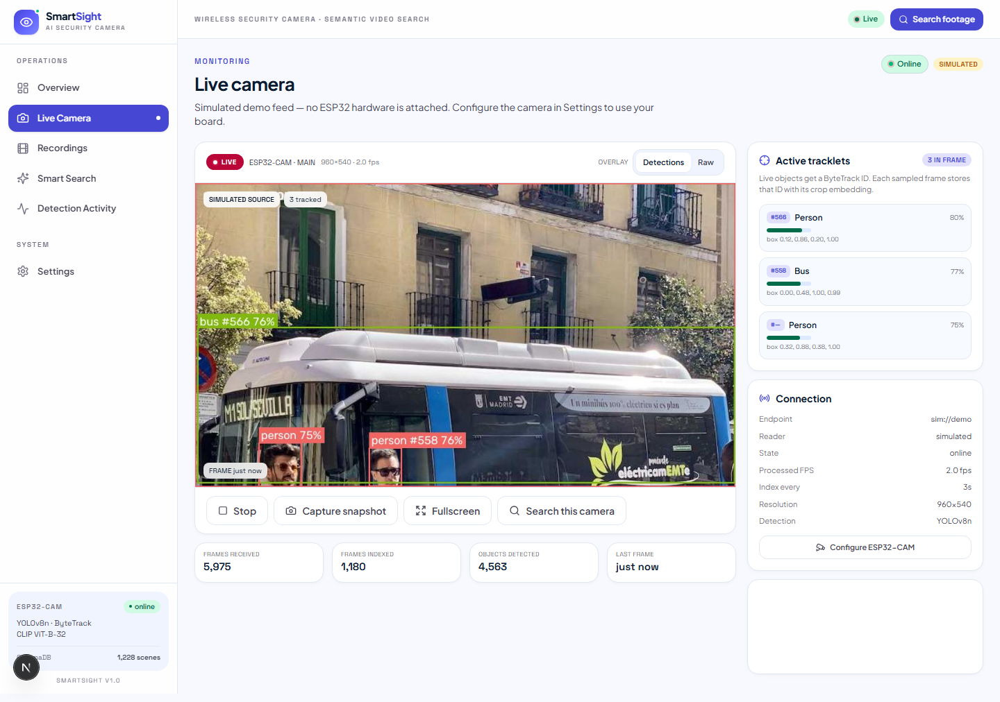
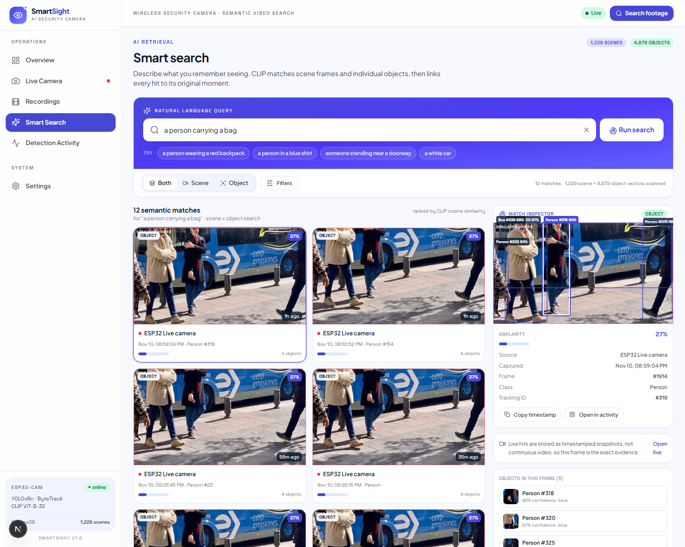
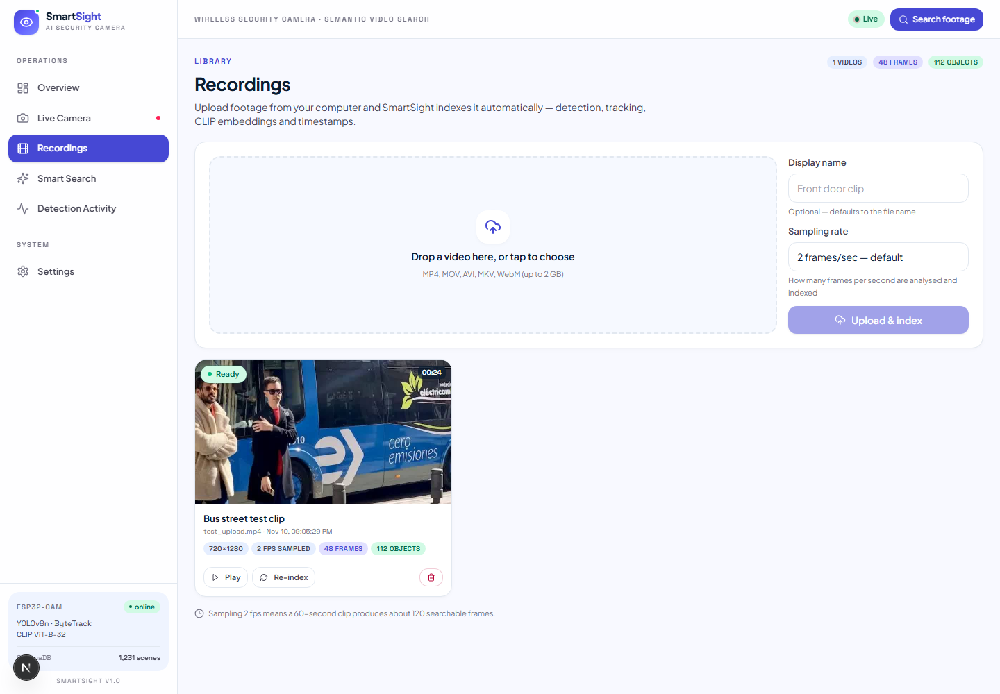
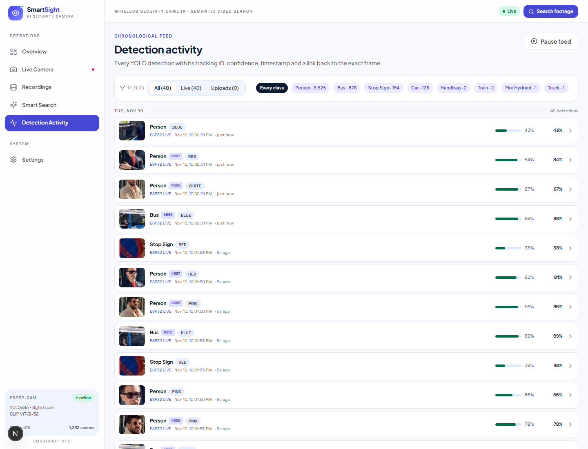
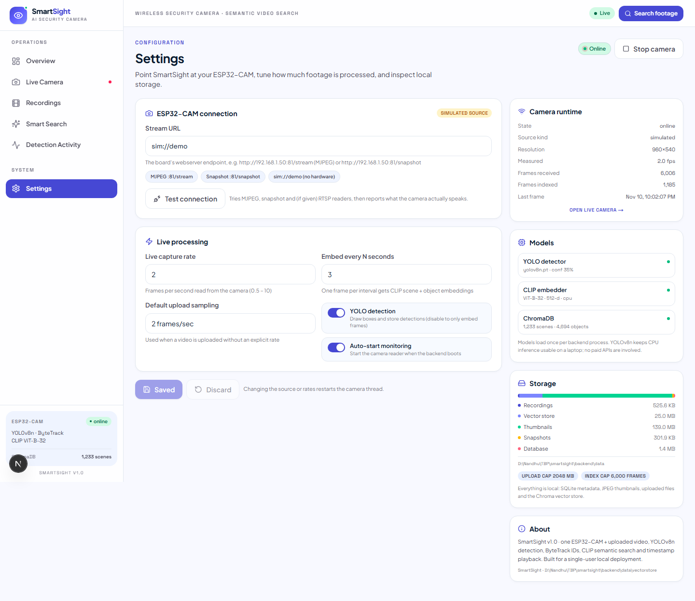
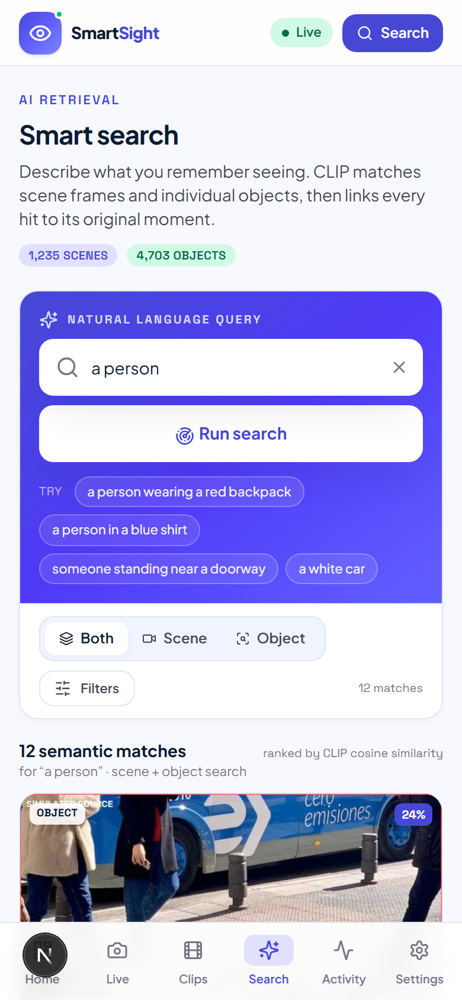
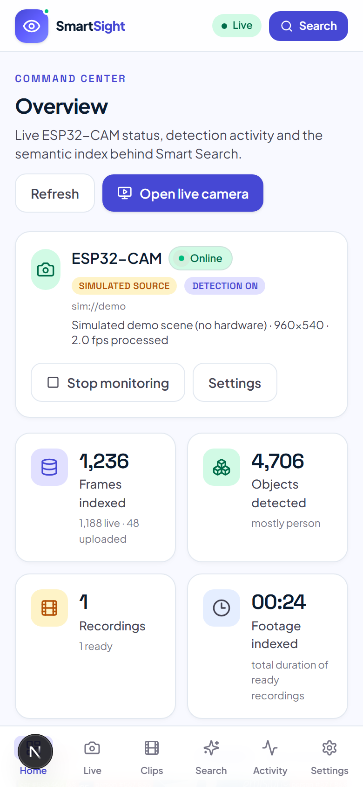
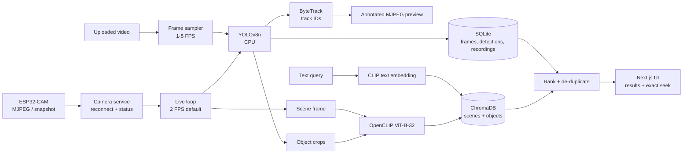

# SmartSight

**AI-powered wireless security camera with semantic video search.**

SmartSight turns one ESP32-CAM (or an uploaded video) into searchable footage. It detects and tracks
objects with YOLOv8n + ByteTrack, embeds every sampled frame and every detected object with CLIP, stores
the vectors in ChromaDB, and lets you find moments in plain language — then jumps to the exact timestamp
in the original recording.



---

## Contents

- [What it does](#what-it-does)
- [Screenshots](#screenshots)
- [Architecture](#architecture)
- [Technology stack](#technology-stack)
- [Repository layout](#repository-layout)
- [Requirements](#requirements)
- [Windows setup](#windows-setup)
- [ESP32-CAM configuration](#esp32-cam-configuration)
- [Using SmartSight](#using-smartsight)
- [How semantic search works](#how-semantic-search-works)
- [API reference](#api-reference)
- [Configuration](#configuration)
- [Testing and verification](#testing-and-verification)
- [Limitations and honest notes](#limitations-and-honest-notes)
- [Credits and licences](#credits-and-licences)

---

## What it does

- **One live camera.** Connects to an ESP32-CAM webserver over Wi-Fi, auto-detects whether it serves
  MJPEG or JPEG snapshots, reconnects when the board drops, and shows connection status.
- **Object detection and tracking.** YOLOv8n draws boxes, labels, confidence scores and ByteTrack IDs;
  every detection is stored with the frame, timestamp, source and track ID.
- **Two kinds of CLIP embeddings.** A whole-frame *scene* embedding and a *crop* embedding for each
  detected object, stored in separate ChromaDB collections. That makes both “a person standing near a
  door” and “a person in a red shirt” retrievable.
- **Natural-language search.** Scene, Object or Both modes; similarity scores, result limits, source,
  recording, class and time filters, and a minimum-similarity threshold.
- **Timestamp playback.** Each result links to its frame and, for uploaded videos, seeks the player to
  the exact second (HTTP Range streaming). Live hits open the stored snapshot for that moment.
- **Video uploads.** MP4, MOV, AVI, MKV, WebM, M4V; sampled at a configurable 1–5 FPS, processed in the
  background with live progress, and re-indexable or cancellable.
- **Detection activity.** A chronological feed grouped by day, filterable by class and source, with a
  frame inspector that replays the detection boxes.
- **Local and lightweight.** CPU-first inference, SQLite + local JPEGs + local Chroma store; no cloud,
  no GPU requirement, no message queue or container stack.
- **Responsive UI.** Desktop sidebar layout and an Android-friendly bottom navigation bar.

---

## Screenshots

| Overview | Live camera |
| --- | --- |
|  |  |

| Smart search with timestamp-linked inspector | Recordings and indexing |
| --- | --- |
|  |  |

| Detection activity | Settings |
| --- | --- |
|  |  |

| Mobile search (Android browser) | Mobile overview |
| --- | --- |
|  |  |

> The camera shown in these screenshots is the **simulated demo source** (`sim://demo`), clearly labelled
> in the UI. See [ESP32-CAM configuration](#esp32-cam-configuration) for the hardware status.

---

## Architecture



Processing pipeline, in order:

1. Frames arrive from the ESP32-CAM reader (or are sampled from an uploaded file).
2. YOLOv8n detects objects in the frame.
3. ByteTrack assigns stable IDs to those objects.
4. The full frame produces a **scene embedding**; each detection crop produces an **object embedding**
   (crops are padded so CLIP sees some context).
5. Vectors go to separate ChromaDB collections with metadata (source, recording, frame, timestamp,
   class, track ID, confidence, thumbnail).
6. Frame/detection rows go to SQLite and JPEG thumbnails to `backend/data/thumbs`.
7. A query is embedded with the CLIP text encoder, both collections are searched, near-duplicates are
   removed, and results are joined with SQLite metadata for thumbnails, boxes and playback links.

Live processing and uploaded-video processing share the same analyser, so detection, tracking,
embeddings and storage behave identically for both sources.

---

## Technology stack

| Layer | Choice |
| --- | --- |
| Backend | Python 3.12, FastAPI, Uvicorn, Pydantic Settings |
| Database | SQLAlchemy 2.0 + SQLite |
| Detection | Ultralytics YOLOv8n (`yolov8n.pt`) |
| Tracking | `supervision` ByteTrack (`supervision==0.24.0`) |
| Embeddings | OpenCLIP `ViT-B-32` / `laion400m_e32`, CPU by default |
| Vector store | ChromaDB persistent client |
| Video I/O | OpenCV (FFmpeg build), Pillow |
| Frontend | Next.js 16 App Router, React 19, TypeScript |
| Styling | Tailwind CSS 4 with a custom light-indigo design system |
| Data fetching | TanStack Query + Axios |
| Icons | lucide-react |

No Docker, Kafka, Redis, Celery, Kubernetes or multi-GPU infrastructure is used. Uploaded videos are
processed by one worker thread with a queue; live frames are analysed in a single camera thread.

---

## Repository layout

```
smartsight/
├─ backend/
│  ├─ app/
│  │  ├─ api/routers/        # camera, recordings, search, system, media endpoints
│  │  ├─ core/               # settings, torch thread configuration
│  │  ├─ db/                 # SQLAlchemy models and session
│  │  ├─ services/
│  │  │  ├─ camera/          # ESP32 sources, probe, simulated source, live service
│  │  │  ├─ detection/       # YOLO wrapper + annotation
│  │  │  ├─ embedding/       # CLIP wrapper
│  │  │  ├─ indexing/        # video indexer queue, recording helpers
│  │  │  ├─ vectorstore/     # Chroma collections
│  │  │  ├─ analysis.py      # shared detect → track → embed → persist pipeline
│  │  │  ├─ search.py        # semantic search, ranking, de-duplication
│  │  │  └─ overview.py      # dashboard aggregates and storage stats
│  │  ├─ assets/demo_scene.jpg
│  │  ├─ http_range.py       # Range streaming for <video> seeking
│  │  └─ main.py
│  ├─ tests/                 # pytest unit tests
│  ├─ data/                  # runtime data (git-ignored)
│  ├─ requirements.txt
│  └─ yolov8n.pt
├─ frontend/
│  └─ src/
│     ├─ app/                # overview, live, recordings, search, activity, settings
│     ├─ components/         # AppShell, VideoPlayer, FrameInspector, UI kit
│     ├─ lib/                # API client, formatters
│     └─ types/
├─ docs/screenshots/
├─ .env.example
└─ .gitignore
```

---

## Requirements

- Windows 10/11 (verified on Windows 11), Linux/macOS should work with the same commands adapted.
- Python **3.11 or 3.12**, 64-bit.
- Node.js **20+** and npm.
- ~8 GB RAM recommended. Models run on CPU; a GPU is optional.
- ESP32-CAM with the standard `CameraWebServer` sketch (optional — SmartSight can run on the labelled
  simulated source).
- First run downloads OpenCLIP weights from Hugging Face (~400 MB) and caches them in
  `%USERPROFILE%\.cache\huggingface`.

---

## Windows setup

### 1. Backend

```powershell
cd smartsight\backend
py -3.12 -m venv .venv
.\.venv\Scripts\Activate.ps1

python -m pip install --upgrade pip
# CPU-only PyTorch first (smaller download than the default CUDA wheel):
pip install torch torchvision --index-url https://download.pytorch.org/whl/cpu
pip install -r requirements.txt

python -m uvicorn app.main:app --host 127.0.0.1 --port 8000
```

The backend is ready at <http://127.0.0.1:8000>; interactive API docs are at
<http://127.0.0.1:8000/docs>. On first start it creates `backend/data` and starts the camera service
using `STREAM_URL_DEFAULT` (default `sim://demo`).

> **Note:** the development venv in this workspace was created with `--system-site-packages` to reuse an
> existing CPU PyTorch install. A normal venv with the steps above works too.

If `Activate.ps1` is blocked by execution policy:

```powershell
Set-ExecutionPolicy -Scope Process -ExecutionPolicy Bypass
```

### 2. Frontend

```powershell
cd smartsight\frontend
npm install
npm run dev
```

Open <http://localhost:3000>. The frontend calls `http://localhost:8000` by default. To use another API
host, create `frontend/.env.local`:

```
NEXT_PUBLIC_API_URL=http://localhost:8000
```

### 3. Production build (optional)

```powershell
cd smartsight\frontend
npm run build
npm start
```

### Resetting the demo data

All runtime state lives in `backend/data` (SQLite, thumbnails, snapshots, uploads, Chroma). Stop the
backend, delete that folder, and restart for a clean install.

---

## ESP32-CAM configuration

SmartSight **does not assume RTSP**. It probes the endpoints that ESP32 camera firmwares commonly expose:

| Firmware / endpoint | URL |
| --- | --- |
| `CameraWebServer` MJPEG stream | `http://<board-ip>/stream` or `http://<board-ip>:81/stream` |
| Snapshot-only builds | `http://<board-ip>/capture` or `http://<board-ip>/snapshot` |
| RTSP bridge (only if you run one) | `rtsp://<host>:554/...` |
| No hardware | `sim://demo` (clearly labelled simulated scene) |

### Steps

1. Flash the standard Arduino ESP32 `CameraWebServer` example (board: **AI Thinker ESP32-CAM**), set
   your 2.4 GHz Wi-Fi SSID/password, and open the serial monitor to read the board's IP address.
2. Open the board's own web page once to confirm video works in a browser.
3. In SmartSight, open **Settings → ESP32-CAM connection**.
4. Enter the URL, e.g. `http://192.168.1.50:81/stream` (or just the IP and use the quick presets).
5. Click **Test connection**. SmartSight tries the candidate endpoints, reports which reader worked
   (MJPEG / snapshot / RTSP / simulated) and shows a preview frame.
6. **Save changes**, then **Start camera**. The board does no AI work; every frame is processed on the
   computer.

The camera service handles reconnects, exposes `online / connecting / reconnecting / error` status,
records the last error, and reopens the stream automatically when frames stop arriving.

### Troubleshooting

| Symptom | Check |
| --- | --- |
| `connection refused or host unreachable` | Board and laptop on the same 2.4 GHz network; correct IP; try the board's page in a browser. |
| Connected but no frames | Open `http://<ip>/stream` directly; some builds use port 81, others 80. |
| Stream works, image is slow | Lower **Live capture rate** in Settings (2 FPS is the default) or increase **Embed every N seconds**. |
| Camera drops repeatedly | Weak Wi-Fi/power. Use a stable 5 V supply and keep the board close to the router. |
| RTSP only | Only configure it if you actually run an RTSP bridge; it is not assumed. |

> **Hardware status:** no physical ESP32-CAM was available during development. The live ingestion,
> detection, tracking, indexing and search paths were verified with the clearly labelled `sim://demo`
> source, which produces a realistic 960×540 frame stream. The probe and reader code paths for MJPEG,
> snapshot and RTSP are implemented and unit-tested, but **real-hardware integration was not verified**
> and must be checked with your board using the steps above.

---

## Using SmartSight

### Overview

Camera status and source, start/stop, live annotated preview, frames indexed, objects detected,
recordings, indexed footage duration, recent detection thumbnails, AI pipeline readiness, storage
breakdown and recent activity. Refreshes every 5 seconds.

### Live camera

- Server-annotated MJPEG preview with boxes, labels, confidence and track IDs; toggle **Detections** vs
  **Raw**.
- Start/stop monitoring, capture a snapshot (saved under `backend/data/snapshots`), fullscreen.
- **Active tracklets** panel lists the current ByteTrack IDs and boxes for the frame.
- **Search this camera** opens Smart Search pre-filtered to live frames.

Every `Embed every N seconds` (default 3 s) one frame is fully analysed and embedded; the preview itself
runs at the configured capture rate (default 2 FPS).

### Recordings

- Drag and drop (or choose) an MP4/MOV/AVI/MKV/WebM file, optionally rename it and pick a sampling rate.
- The file is validated, probed with OpenCV, stored under `backend/data/recordings`, and queued.
- Each card shows status (`queued`, `processing`, `ready`, `failed`, `cancelled`), percent progress,
  frames/objects indexed, resolution and duration. Play, re-index, cancel and delete are real actions.
- Re-indexing purges that recording's frames, detections, thumbnails and vectors before reprocessing.

### Smart search

- Enter a description and press **Run search**. Example chips are provided, plus deep links:
  `/search?q=a%20person%20carrying%20a%20bag` or `/search?source=live`.
- **Both / Scene / Object** mode switches which collections are queried.
- Filters: source (live/uploads), specific recording, detected class, time window, result limit
  (12/24/48) and minimum similarity.
- Results show the thumbnail, match type, similarity, source, capture time, footage timestamp, class,
  track ID and object count.
- The **inspector** shows the frame with all detection boxes (the matched object is highlighted),
  metadata, copy-timestamp, a link into Detection Activity, and — for uploads — a video player already
  seeked to the matching second.

### Detection activity

Chronological feed grouped by day, filterable by class chips and source, with pause/resume
auto-refresh. Selecting a row opens the frame with boxes, its detections and the original video seeked
to that moment (uploads) or the snapshot explanation (live).

### Settings

Stream URL with endpoint presets and connection test, live capture rate, embedding interval, default
upload sampling, YOLO detection and auto-start toggles, camera runtime, model/vector counts, and storage
usage. Changing the source or a rate restarts the camera thread.

---

## How semantic search works

1. The query is encoded with the same CLIP model used for images (`ViT-B-32`).
2. Scene and object collections are queried independently with cosine similarity.
3. Candidates below the minimum similarity are dropped.
4. Near-identical results are collapsed: at most one **scene** hit per 4-second footage window, and at
   most one **object** hit per track identity per 5-second window. For uploads the video timeline is
   used, not the indexing wall clock.
5. **Both** mode keeps a balanced mix (half scene, half object) and never returns the same frame twice.
6. Results are joined with SQLite for thumbnails, boxes, source and playback metadata.

CLIP retrieves **appearance**, not events. Queries like “someone entering the room” return visually
related frames as approximate evidence; SmartSight does not claim action recognition or temporal
reasoning. Similarity scores are relative to the index — a 25% score can be the best match in a small
collection.

---

## API reference

Base URL: `http://127.0.0.1:8000/api`. Interactive docs: `/docs`.

### System

| Method | Path | Description |
| --- | --- | --- |
| GET | `/health` | App, camera and AI status (models loaded, vector counts). |
| GET | `/overview` | Dashboard aggregates, camera stats, storage, recent detections, activity. |
| GET | `/activity` | Detection feed. Query: `limit`, `object_class`, `source_type`. Returns `items` and `classes`. |
| GET | `/frames/{frame_id}` | Frame detail: dimensions, timestamp, scene vector id and detections. |
| GET | `/settings` | Camera config, runtime, indexing limits, AI and storage status. |
| PUT | `/settings` | Update camera/indexing settings (partial JSON). |

### Camera

| Method | Path | Description |
| --- | --- | --- |
| GET | `/camera/status` | Runtime status plus saved config. |
| POST | `/camera/start` / `/camera/stop` | Start or stop monitoring. |
| PUT | `/camera/config` | Same fields as `PUT /settings`. |
| POST | `/camera/test` | Probe a URL (`{"stream_url": "..."}`); returns reader kind, resolution and preview. |
| GET | `/camera/stream?overlay=true` | MJPEG preview (annotated or raw). |
| GET | `/camera/snapshot?overlay=true` | Current frame as JPEG. |
| POST | `/camera/snapshot?overlay=true` | Save a snapshot under `data/snapshots`; returns its URL. |
| GET | `/camera/detections` | Detections and track IDs for the latest processed frame. |

### Recordings

| Method | Path | Description |
| --- | --- | --- |
| GET | `/recordings` | List recordings with status, progress and counters. |
| POST | `/recordings` | Multipart upload: `file`, optional `name`, optional `sample_fps`. Returns 201. |
| GET | `/recordings/{id}` | One recording. |
| GET | `/recordings/{id}/progress` | Recording plus indexer active/queued state. |
| POST | `/recordings/{id}/reindex` | Purge this recording's index and queue it again. |
| POST | `/recordings/{id}/cancel` | Cancel queued or running indexing. |
| DELETE | `/recordings/{id}` | Delete the file, frames, vectors and thumbnails. |
| GET | `/recordings/{id}/playback` | Video with HTTP Range support (206/416) for seeking. |

### Search and media

| Method | Path | Description |
| --- | --- | --- |
| POST | `/search` | Semantic search (body below). |
| GET | `/search/examples` | Suggested natural-language queries. |
| GET | `/search/stats` | Number of scene and object vectors. |
| GET | `/media/thumb/{filename}` | JPEG thumbnail. |
| GET | `/media/snapshot/{filename}` | Saved snapshot. |

**Search request**

```json
{
  "query": "a person carrying a red backpack",
  "mode": "both",
  "limit": 12,
  "source_type": "upload",
  "recording_id": 1,
  "object_class": "person",
  "start": "2026-11-10T00:00:00Z",
  "min_score": 0.0
}
```

`mode` is `both`, `scene` or `object`. `source_type` is `live` or `upload` when filtering. `start` and
`end` are ISO timestamps compared with when frames were captured (live) or indexed (uploads).

**Upload example (Windows)**

```powershell
curl.exe -X POST http://127.0.0.1:8000/api/recordings `
  -F "file=@C:\videos\front-door.mp4;type=video/mp4" `
  -F "name=Front door" -F "sample_fps=2"
```

---

## Configuration

Copy `.env.example` to `smartsight/.env` (backend) and set frontend values in `frontend/.env.local`.

| Variable | Default | Purpose |
| --- | --- | --- |
| `APP_NAME` | `SmartSight` | API title. |
| `CORS_ORIGINS` | `http://localhost:3000,http://127.0.0.1:3000` | Allowed browser origins. |
| `DATA_DIR` | `backend/data` | SQLite, thumbnails, snapshots, recordings, Chroma. |
| `DATABASE_URL` | `sqlite:///backend/data/smartsight.db` | Metadata database. |
| `CHROMA_DIR` | `backend/data/vectorstore` | Chroma persistence directory. |
| `DETECTOR_MODEL` | `backend/yolov8n.pt` | YOLO weights. |
| `DETECTOR_CONFIDENCE_THRESHOLD` | `0.35` | Detection threshold. |
| `CLIP_MODEL` / `CLIP_PRETRAINED` | `ViT-B-32` / `laion400m_e32` | CLIP backbone and weights. |
| `CLIP_DEVICE` | `cpu` | `cuda` if you have a supported GPU. |
| `TORCH_THREADS` | `0` (auto) | CPU threads; auto = half the cores, max 4. |
| `STREAM_URL_DEFAULT` | `sim://demo` | Initial camera setting. |
| `LIVE_FPS_DEFAULT` | `2` | Live capture rate. |
| `LIVE_INDEX_INTERVAL_DEFAULT` | `3` | Seconds between embedded live frames. |
| `SAMPLE_FPS_DEFAULT` | `2` | Default upload sampling rate. |
| `VIDEO_UPLOAD_MAX_MB` | `2048` | Upload size cap. |
| `VIDEO_INDEX_MAX_FRAMES` | `6000` | Safety cap on frames indexed per video. |
| `THUMBNAIL_MAX_WIDTH` | `720` | Thumbnail width. |
| `NEXT_PUBLIC_API_URL` | `http://localhost:8000` | Frontend API base. |

Camera runtime values (stream URL, rates, toggles) live in the `camera_config` row in SQLite and are
edited in Settings; environment defaults only apply on first creation.

---

## Testing and verification

### Automated tests

```powershell
cd smartsight\backend
.\.venv\Scripts\Activate.ps1
python -m pytest tests -q
```

Result on this machine: **19 passed**.

- `tests/test_http_range.py` — full response, middle/open-ended/suffix ranges, 206/416 headers.
- `tests/test_camera_sources.py` — ESP32 URL expansion, exact URLs, RTSP/simulated pass-through.
- `tests/test_search_dedupe.py` — footage-timeline keys, aligned window de-duplication, per-recording isolation.
- `tests/test_recordings.py` — video probing, missing/corrupt files, supported extensions.

Frontend checks:

```powershell
cd smartsight\frontend
npx tsc --noEmit      # exit 0
npm run build         # production build succeeds
```

### End-to-end checks performed

| Check | Result |
| --- | --- |
| Backend starts, models load (YOLO + CLIP), camera auto-starts | Pass |
| Live frames received and annotated | Pass (simulated source, 960×540, ~2 FPS) |
| YOLO detections stored with class/confidence/box | Pass (e.g. person, bus, stop sign) |
| ByteTrack assigns and maintains IDs | Pass (IDs 35, 37, 49, 318, 558 … observed across frames) |
| CLIP scene embeddings generated and stored | Pass (1,200+ scene vectors) |
| CLIP object crop embeddings generated and stored | Pass (4,600+ object vectors) |
| ChromaDB counts match SQLite frames/detections | Pass |
| Video upload validates and queues | Pass (24 s / 720×1280 test clip) |
| Background indexing with progress → ready | Pass (48 frames, 112 objects in ~2 min 20 s at 2 FPS sampling) |
| Scene search returns matching moments | Pass ("a yellow bus on the street" → 0 s, 4 s, 8 s, 16 s …) |
| Object search with class filter | Pass (person crops with track IDs) |
| Near-duplicate suppression | Pass (one hit per 4 s scene / 5 s object window) |
| Result thumbnails resolve | Pass (24/24 results returned HTTP 200 images) |
| Frame detail returns normalized boxes and dimensions | Pass |
| Range playback supports seeking | Pass (206 with correct `Content-Range`, 416 beyond EOF) |
| Player seeks to the matched timestamp | Pass (H.264 clip, `currentTime` = 8.00 s, then 9.50 s after re-index) |
| Snapshot capture and retrieval | Pass (saved JPEG served with HTTP 200) |
| Connection probe success and failure paths | Pass (`sim://demo` ok; unreachable host returns a concise error) |
| ESP32-CAM hardware end-to-end | **Not tested — no board available** |
| Frontend pages render with live API data | Pass (desktop + 390 px mobile screenshots) |

### Measured performance (6-core CPU laptop)

- YOLOv8n at 640 px: ~0.37 s per frame.
- CLIP image encoding: ~1.3 s for 5 images after warm-up; first call includes model load.
- Uploaded video indexing at 2 FPS sampling: ~2.9 s per frame including detection, crops, embeddings,
  SQLite writes and Chroma inserts.
- Live mode: 2 FPS preview detections with a full embedding every 3 s, without blocking the UI.

These figures are from the development machine and will vary with CPU, clip complexity and object count.

---

## Limitations and honest notes

- **Hardware not verified.** No physical ESP32-CAM was available; all live checks used the labelled
  `sim://demo` source. Simulation does not prove hardware integration. Use the Settings connection test
  and the troubleshooting table to validate your board.
- **Live footage is snapshots, not rolling video.** Live frames are stored as timestamped JPEGs plus
  their embeddings; there is no continuous live recording. Uploaded videos do provide full timestamp
  playback.
- **CLIP is appearance-based.** It cannot reliably recognise actions, intent or temporal events. Action
  queries return approximate visual evidence.
- **Single camera, single user.** No cross-camera ReID, multi-camera management or authentication by
  design — intended for a local single-user deployment. Do not expose the API to an untrusted network.
- **Time filters** use capture time for live frames and indexing time for uploads; the UI labels this.
- **Codec support in browsers.** Chrome/Edge play H.264/AAC MP4 and WebM. Some exotic codecs (for
  example MPEG-4 Part 2 produced by OpenCV's default writer) are not decodable by browsers even though
  SmartSight indexes them; transcode such files to H.264 first.
- **Model licences.** Ultralytics YOLOv8 is AGPL-3.0; review the licence before distributing.
- Windows Application Control on this machine blocks a few optional native wheels. The project pins
  `sqlalchemy<2.1` and `supervision==0.24.0` for compatibility; no elevation is required to run it.

---

## Credits and licences

- [Ultralytics YOLOv8](https://github.com/ultralytics/ultralytics) — object detection (AGPL-3.0).
- [ByteTrack](https://github.com/ifzhang/ByteTrack) via [supervision](https://github.com/roboflow/supervision).
- [OpenCLIP](https://github.com/mlfoundations/open_clip) — CLIP implementation and weights.
- [ChromaDB](https://github.com/chroma-core/chroma) — local vector store.
- [FastAPI](https://fastapi.tiangolo.com/) and [Next.js](https://nextjs.org/) — backend and frontend.
- Demo scene: Ultralytics `bus.jpg`, used only by the simulated camera source.
